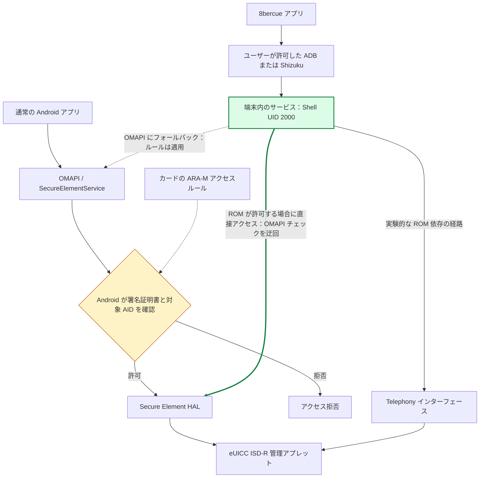

  

  <a href="README.md" lang="en">English</a> ·
  <a href="README.zh-CN.md" lang="zh-CN">简体中文</a> ·
  <strong lang="ja">日本語</strong>

<h1 align="center">8bercue</h1>

Android 向けのオープンソース着脱式 eUICC カード管理アプリ。

  <a href="https://github.com/sidnvy/8bercue/releases/tag/v0.20.0-beta.7">Beta をダウンロード</a> ·
  <a href="docs/ADB_CONNECTION.md">接続方法</a> ·
  <a href="docs/COMPATIBILITY.md">互換性</a> ·
  <a href="CONTRIBUTING.md">貢献する</a> ·
  <a href="https://github.com/sidnvy/8bercue/issues">問題を報告</a>

自分の Android スマートフォンで、対応する着脱式 eUICC カード内の eSIM プロファイルを管理できます。
カードの読み取り、アクティベーションコードや QR コードによる追加、プロファイルの切り替えを、
カードベンダーのアプリやアカウントを経由せずに行えます。

このプロジェクトは 5ber カードから始まり、現在はさまざまなベンダーのカードへの対応を目指しています。
9eSIM、Nekoko、海豚卡、その他の着脱式 eUICC を対象に、
**端末・ROM・カード・操作** の組み合わせごとに結果を記録します。
ベンダーの許可リストはありません。カードの購入や操作の可否を判断する前に、
[実際に確認された範囲](docs/COMPATIBILITY.md) をご覧ください。

  
  &nbsp;&nbsp;
  

## ダウンロードと使い方

現在公開中の Beta は **[0.20.0-beta.7 / APK55](https://github.com/sidnvy/8bercue/releases/tag/v0.20.0-beta.7)** です。
署名済み APK を **ARM64・Android 9 以降** の端末にインストールしてください。
更新時は既存の公式版に上書きインストールすると、アプリのデータとペアリング情報を維持できます。
カードにアクセスできるかどうかは、ROM が提供するインターフェースとカード自体にも依存します。

アプリの UI は現在、英語と簡体字中国語に対応しています。以下の操作名は英語表記です。
**Connection & access** を開き、接続方法を選びます。

| 方法 | 必要なもの | 手順 |
| --- | --- | --- |
| This phone · Wireless ADB | Android 12 以降、Wi-Fi、Android のワイヤレスデバッグ | 8bercue の通知から一度ペアリングし、以後は保存された情報で再接続 |
| Computer · USB ADB | USB デバッグと、ADB を利用できる信頼済みのパソコン | アプリに表示された固定コマンドを接続待機時間内に実行 |
| Shizuku | ADB / Shell モードで起動済みの Shizuku | Shizuku を選び、通常の権限ダイアログで 8bercue を許可 |

どの方法も、端末内で同じ Shell コンパニオンサービスを起動します。アプリが root 権限を取得することはありません。
Shizuku は任意で、対応するサービスが動作中の場合にのみ選択肢が表示されます。
root で起動した Shizuku と Sui には対応していません。

ワイヤレスでペアリングする際は、Android のペアリングコード画面を開いたままにしてください。
8bercue の通知にある **Enter pairing code** から 6 桁の数字を入力し、その後アプリに戻ります。
[初回設定と再接続のガイド](docs/ADB_CONNECTION.md) を参照してください。

接続後、求められた場合は管理対象のカードを選びます。プロファイルは自動で読み取られ、
**Refresh** で再読み取りできます。変更する前に、まず一覧を確認してください。
[自分の端末で確認して結果を報告する](docs/NEW_DEVICE_CHECK.md)。

## カード管理機能

- プロファイルの一覧表示とカード情報の確認。
- 対応する管理経路でのプロファイルの有効化、無効化、名前変更、削除。
- QR コード、画像、アクティベーションコードからのプロファイルのダウンロード。
- 英語・簡体字中国語の UI と、ライト・ダークテーマ。
- 通信中断後の読み取りの復旧。過去の有効化・無効化については、記録された操作意図と
  新たに読み取ったカード全体の一覧から正確な結果を証明できる場合にのみ、自動で確認。

本アプリは **Beta 版** です。読み取りに成功しても、ダウンロード、切り替え、モバイル通信まで確認されたことにはなりません。
現在、有効にできるプロファイルはカードごとに 1 つで、MEP による同時有効化には対応していません。
確認済みの変更後にコンパニオンのセッションを再作成する場合、複数のカードがある端末では、現在はカードの再選択が必要です。
確認済みの範囲と残る制限は [リリースノート](https://github.com/sidnvy/8bercue/releases/tag/v0.20.0-beta.7) をご覧ください。

## OMAPI のアプリチェックを迂回する仕組み

**迂回するのは、Android の OMAPI アプリアクセスチェックです。** 通常のアプリが
OMAPI 経由で ISD-R にアクセスする際、Android はカードのアクセスルールに基づき、
アプリの署名証明書と対象アプレットを確認します。対応する ROM では、8bercue は
ユーザーが許可した **Shell サービス（UID 2000）** から HAL を直接呼び出すか、
利用可能な Telephony 経路を使い、この OMAPI アプリチェックを経由せずにアクセスします。

通常、アプリが OMAPI 経由でカードのアプレットを開く際には、Android がアクセス権を確認します。
ルールはカード上の **ARA-M** アプレットから提供される場合があり、アプリの署名証明書によって許可対象を識別します。
ベンダーはこの経路で自社のアプリを許可できます。

対応する ROM では、許可された Shell コンパニオンが、通常の OMAPI アプリ権限チェックより下層の
Secure Element HAL にアクセスできます。端末によっては Telephony 経由のアクセスも利用できます。
OMAPI へのフォールバックでは、引き続き OMAPI のアクセスルールに従います。
変わるのは Android 側のアクセス経路であり、ARA-M の書き換え、カードのファームウェアの解除、
通信事業者の認証の置き換えを行うものではありません。

独立した管理アプリを使うことで、ベンダーのアプリやアカウントサービス内だけで実装されている
登録要件やダウンロード回数の制限を経由せずに管理できます。
**無制限のダウンロードを保証するものではありません。** カードの容量やファームウェア、コードの利用条件、
通信事業者の利用資格、プロファイルサーバーのポリシーによる制約は引き続き適用されます。

[アーキテクチャと権限の境界](docs/ARCHITECTURE.md) では、接続、ARA-M の確認、カードのプロトコル、
通信事業者の認証を分けて説明しています。

## 対応する端末とカードを増やす

アプリは端末ブランドの許可リストではなく、実際のサービスとカードの応答に基づいて検出します。
アダプター層は Secure Element AIDL、HIDL、Telephony、OMAPI を扱い、経路ごとに権限要件と操作範囲が異なります。

次の方法で貢献できます。

- **端末とカードの組み合わせを確認する：** [読み取り専用の端末確認](docs/NEW_DEVICE_CHECK.md) を行い、
  [端末レポート](https://github.com/sidnvy/8bercue/issues/new?template=device-compatibility.yml) を提出してください。
  動作した結果も、再現可能な失敗も役立ちます。
- **ROM アダプターを改善する：** [アダプターガイド](docs/ADAPTERS.md) で失敗するインターフェースを特定し、
  再利用可能な修正と、対象を絞った回帰テストを追加してください。
- **アプリや文書を改善する：** 分かりにくい手順の報告、翻訳の改善、範囲を絞った PR を歓迎します。

[貢献ガイド](CONTRIBUTING.md) に、レポートの形式、コードの責務、検証要件をまとめています。
新しい端末の動作報告は、実行時コードを変更せず互換性表だけを更新する形でも提出できます。
Issue、レビュー、貢献には [コミュニティ行動規範](CODE_OF_CONDUCT.md) が適用されます。

公開レポートには簡潔な結果を記載し、端末セッションのアーカイブ全体を添付しないでください。
完全な EID / ICCID、アクティベーションコード、生のプロトコルログは非公開にしてください。
詳細なテスト証拠はソースツリーの外で保管し、依存関係の出所、ライセンス、必要な回帰テスト用データはプロジェクトに残します。

## 詳細情報

リンク先の詳細ガイドは、現在主に英語で提供しています。

- [ソースからビルド](BUILDING.md)
- [接続設定](docs/ADB_CONNECTION.md)
- [カードと端末の互換性](docs/COMPATIBILITY.md)
- [中断した操作と復旧](docs/READ_ONLY_RECOVERY.md)
- [プライバシー](PRIVACY.txt)
- [AGPL-3.0-only と限定的な BoringSSL リンク例外](LICENSING.md)

開発：sid · [support@sidnvy.com](mailto:support@sidnvy.com)

8bercue は、本文で言及したベンダーとは独立したプロジェクトです。
製品名はカードや互換性レポートを識別するためのもので、提携や推奨を意味しません。
