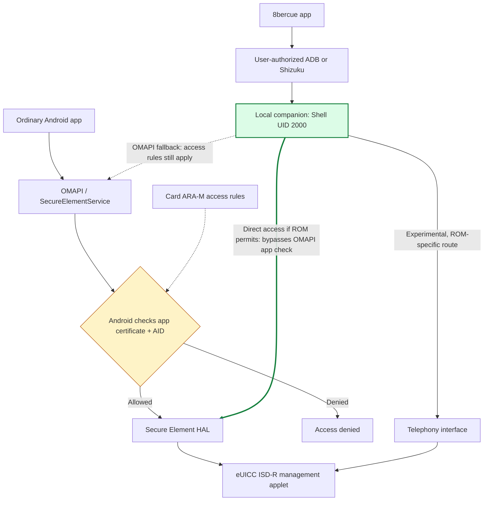

  

  <strong lang="en">English</strong> ·
  <a href="README.zh-CN.md" lang="zh-CN">简体中文</a> ·
  <a href="README.ja.md" lang="ja">日本語</a>

<h1 align="center">8bercue</h1>

An open-source eSIM manager for removable eUICC cards on Android.

  <a href="https://github.com/sidnvy/8bercue/releases/tag/v0.20.0-beta.7">Download Beta</a> ·
  <a href="docs/ADB_CONNECTION.md">Set up</a> ·
  <a href="docs/COMPATIBILITY.md">Compatibility</a> ·
  <a href="CONTRIBUTING.md">Contribute</a> ·
  <a href="https://github.com/sidnvy/8bercue/issues">Feedback</a>

Manage the eSIM profiles on a compatible removable eUICC using your own phone.
Read the card, add profiles from an activation code or QR code, and switch
profiles without going through a card vendor's app or account.

The project began with 5ber cards and now aims to work across card vendors.
9eSIM, Nekoko, 海豚卡 and other removable eUICCs belong in the same compatibility
work, with results recorded for each **phone, ROM, card and operation**.
There is no vendor allowlist. See [what has actually been tested](docs/COMPATIBILITY.md)
before choosing a card or assuming a particular operation works.

  
  &nbsp;&nbsp;
  

## Download and start

The current published Beta is **[0.20.0-beta.7 / APK55](https://github.com/sidnvy/8bercue/releases/tag/v0.20.0-beta.7)**.
Download its signed APK and install it on an **ARM64 Android 9+** phone.
For an upgrade, install over the existing official version to keep app data and
pairing identity. Card access depends on the ROM's interfaces and the card itself.

Open **Connection & access** and choose a method:

| Method | What you need | What to do |
| --- | --- | --- |
| This phone · Wireless ADB | Android 12+, Wi-Fi and Android wireless debugging | Pair through the 8bercue notification once; reconnect with the saved identity |
| Computer · USB ADB | USB debugging and a trusted computer with ADB | Run the fixed command displayed by the app during its connection window |
| Shizuku | Shizuku already running in ADB/Shell mode | Select Shizuku and allow 8bercue in its normal permission prompt |

These methods start the same local Shell companion. The app does not obtain
root. Shizuku is optional; its entry appears when a compatible service is
running. Root-started Shizuku and Sui are not supported.

For wireless pairing, keep Android's pairing-code window open and enter the
six digits through **Enter pairing code** in the 8bercue notification. Then
return to 8bercue. [Step-by-step setup and reconnect help](docs/ADB_CONNECTION.md).

After connecting, choose the intended card if prompted. Profiles are read
automatically; **Refresh** reads them again. Start by checking the list before
changing anything. [Try your phone and report the result](docs/NEW_DEVICE_CHECK.md).

## Card management

- List profiles and inspect card information.
- Enable, disable, rename and delete profiles on supported management routes.
- Download a profile from a QR code, an image or an activation code.
- Use English or Simplified Chinese, with light and dark themes.
- Recover readable card state after interrupted communication; automatically
  confirm an earlier enable/disable only when the recorded intent and fresh
  complete card inventory prove its exact result.

This is **Beta software**. A successful read does not qualify downloads, switching
or mobile network service. The current manager supports one enabled profile
per card; it does not implement MEP dual-profile operation. After some verified
changes require a new companion session, multi-card phones currently ask you
to select the card again. See the [release notes](https://github.com/sidnvy/8bercue/releases/tag/v0.20.0-beta.7)
for the acceptance scope and remaining limits.

## How 8bercue bypasses the OMAPI app check

**The bypass is at Android's OMAPI app-access check.** An ordinary app reaches
ISD-R through OMAPI only when Android accepts the card's access rules for that
app's signing certificate and target applet. On compatible ROMs, 8bercue uses a
user-authorized **Shell service (UID 2000)** to call the HAL directly, or a usable
Telephony route, without going through that OMAPI application check.

Android normally checks whether an app is allowed to open a card applet through
OMAPI. The rules can come from the card's **ARA-M** applet and identify permitted
apps by signing certificate. A vendor can authorize its own app through that
route.

On compatible ROMs, the authorized Shell companion can reach the Secure Element
HAL below that ordinary OMAPI app check. Other devices may expose a usable
Telephony route. The OMAPI fallback still follows OMAPI access rules. This
changes the Android access route; it does not rewrite ARA-M, unlock the card's
firmware or replace operator authentication.

An independent manager can avoid registration and download counters implemented
only in the vendor's app or account service. **It does not promise unlimited
downloads:** card storage and firmware limits, activation-code usage, operator
entitlement and profile-server policies still apply.

[Architecture and permission boundaries](docs/ARCHITECTURE.md) explains the
connection, ARA-M checks, card protocols and operator authentication separately.

## Help more phones and cards work

The app discovers actual services and card responses instead of admitting
specific phone brands. Its adapter layer covers Secure Element AIDL, HIDL,
Telephony and OMAPI, with different permission and operation limits.

You can contribute in three ways:

- **Test a combination:** follow the [read-only device check](docs/NEW_DEVICE_CHECK.md)
  and submit a [device report](https://github.com/sidnvy/8bercue/issues/new?template=device-compatibility.yml).
  Both working results and reproducible failures help.
- **Improve a ROM adapter:** use the [adapter guide](docs/ADAPTERS.md) to locate
  the failing interface and add a reusable fix with a focused regression.
- **Improve the app and documentation:** report confusing steps, propose a
  translation or send a focused PR.

[CONTRIBUTING.md](CONTRIBUTING.md) describes the report format, code boundaries
and validation. A successful new-device report can update the compatibility
matrix without changing runtime code. [Community conduct](CODE_OF_CONDUCT.md)
applies to issues, reviews and contributions.

Public reports need a concise result, not a device-session archive. Keep full
EID/ICCID, activation codes and raw protocol traces private. Detailed test
evidence stays outside the source tree; dependency provenance, licenses and
necessary regression fixtures remain in the project.

## More information

- [Build from source](BUILDING.md)
- [Connection setup](docs/ADB_CONNECTION.md)
- [Card and phone compatibility](docs/COMPATIBILITY.md)
- [Interrupted operations and recovery](docs/READ_ONLY_RECOVERY.md)
- [Privacy](PRIVACY.txt)
- [AGPL-3.0-only and limited BoringSSL linking permission](LICENSING.md)

Built by sid · [support@sidnvy.com](mailto:support@sidnvy.com)

8bercue is independent of the vendors mentioned here. Product names identify
cards or reports and do not imply affiliation or endorsement.
