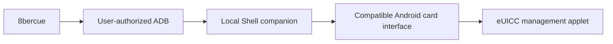

  

<h1 align="center">8bercue</h1>

An open-source eSIM card manager for Android.

  <a href="https://github.com/sidnvy/8bercue/releases">Download APK</a> ·
  <a href="https://github.com/sidnvy/8bercue/releases/tag/v0.20.0-beta.4">Release notes</a> ·
  <a href="CONTRIBUTING.md">Contribute</a> ·
  <a href="https://github.com/sidnvy/8bercue/issues">Feedback</a>

Manage profiles on compatible removable eUICC cards using your own Android phone.
8bercue is built for cards from different vendors, including 5ber, 9eSIM and
海豚卡, rather than a single vendor's ecosystem. You do not need a 5ber
account. See [card and phone compatibility](docs/COMPATIBILITY.md) for what is
known and how to check your combination.

  
  &nbsp;&nbsp;
  

## What it does

- Read profiles and card information.
- Enable, disable, rename and delete profiles when the selected connection supports them.
- Add an eSIM from a QR code, an image or an activation code.
- Set up wireless ADB on the phone, or connect using a computer with USB ADB.
- Use English or Simplified Chinese, with light and dark themes.
- Review sensitive operations and inspect interrupted operations before continuing.

The app is in **Beta**. A successful card read does not establish that every write
operation or network service works on the same device.

## Get started

Install the signed APK from [Releases](https://github.com/sidnvy/8bercue/releases).
The app requires **ARM64 Android 9+** and a compatible eUICC. Actual card access
depends on the phone's ROM, exposed interfaces and permissions.

### On the phone — Android 12+ with Wi-Fi

1. Open **Connection & access → This phone · Wireless ADB**, then **Start setup**,
   and allow notifications.
2. In Android's developer settings, open **Wireless debugging** and choose
   **Pair device with pairing code**.
3. Keep the system code window open. Expand the 8bercue notification, choose
   **Enter pairing code**, and enter the six-digit code there.
4. Return to 8bercue and select the intended card if several are available.

After pairing, choose the wireless method and **Connect on this phone** to reconnect. A computer and Shizuku
are not required for this setup. The app uses an authorized Android Shell
companion; it does not obtain root. Reconnect when the companion has stopped,
such as after a reboot or an app update. Keep wireless debugging available while
using the wireless connection. [Connection help](docs/ADB_CONNECTION.md).

### With a computer

Open **Connection & access → Computer · USB ADB** from Home or Settings.
Computer and wireless are available as equal choices. Copy the displayed
ADB command and run it during the two-minute connection window. Select the
correct device if several phones are connected. The command confirms the local
service connection; card access is checked separately.

Your profiles appear after the card is read automatically; use **Refresh** to
read again. Card information is under **Settings → Advanced**. Connection details,
help and diagnostic export are under **Help & feedback**. [Try a new phone](docs/NEW_DEVICE_CHECK.md).

## How it works

Android's normal OMAPI path checks application access rules supplied by the card,
including ARA-M rules. A card vendor can authorize its own application while
other applications cannot open the same management applet through that path.
Where a ROM allows Shell to use a lower-level Secure Element HAL, 8bercue can
reach the applet through that interface without the ordinary OMAPI application
check. Its OMAPI fallback still follows OMAPI access rules.

This gives an independent card-management client a usable route on compatible
phones. It can avoid a vendor app's account requirement and download counters
that exist only in that app or its account service. It does not remove card
firmware limits, operator activation-code rules or restrictions enforced by the
profile server. eUICC and operator authentication still apply.

[Architecture and permission boundaries](docs/ARCHITECTURE.md) explain ADB pairing,
ARA-M, card protocols and the ROM adapters, with links to the implementation and
Android's access-control design.

## Help more phones and cards work

Compatibility is checked from actual interfaces and card responses, without a
phone-brand allowlist. The transport layer tries Secure Element AIDL, HIDL,
Telephony and OMAPI; each has different availability and operation limits.

Try your own phone with a read-only check. Working combinations and useful
failure reports both help. If a reusable adapter change makes your device work,
submit it with a small test and the relevant device/ROM details. See
[CONTRIBUTING.md](CONTRIBUTING.md) and the [adapter guide](docs/ADAPTERS.md).

Keep activation codes, full EID/ICCID values and raw protocol captures out of
public reports. Use the app's reviewed diagnostic export when needed.

## Build, license and contact

[BUILDING.md](BUILDING.md) covers source builds and signing your own APK.
[Read-only recovery](docs/READ_ONLY_RECOVERY.md) explains interrupted operations.

[AGPL-3.0-only](COPYING), with the limited BoringSSL linking permission described
in [LICENSING.md](LICENSING.md) · [Privacy](PRIVACY.txt)

Built by sid · [support@sidnvy.com](mailto:support@sidnvy.com)

8bercue is independent of the card vendors mentioned here. Names identify cards
or compatibility reports and do not imply affiliation or endorsement.
