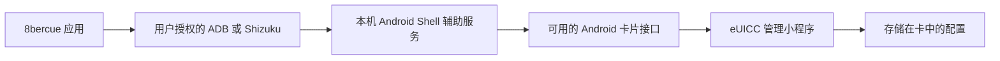

  

  <a href="README.md" lang="en">English</a> ·
  <strong lang="zh-CN">简体中文</strong> ·
  <a href="README.ja.md" lang="ja">日本語</a>

<h1 align="center">8bercue</h1>

用于 Android 的开源可插拔 eUICC 卡片管理工具。

  <a href="https://github.com/sidnvy/8bercue/releases/tag/v0.20.0-beta.7">下载 Beta</a> ·
  <a href="docs/ADB_CONNECTION.md">连接指南</a> ·
  <a href="docs/COMPATIBILITY.md">兼容性</a> ·
  <a href="CONTRIBUTING.md">参与贡献</a> ·
  <a href="https://github.com/sidnvy/8bercue/issues">反馈问题</a>

用你自己的 Android 手机管理兼容的可插拔 eUICC 卡中的 eSIM 配置。
读取卡片，通过激活码或二维码添加配置，以及切换配置，无需经过卡片厂商的应用或账号。

项目最初面向 5ber 卡，现在希望兼容不同厂商的卡片。
9eSIM、Nekoko、海豚卡和其他可插拔 eUICC 都属于兼容性工作的范围，
测试结果按 **手机、ROM、卡片和具体操作** 分别记录。
项目没有厂商品牌白名单。选购卡片或判断某项操作是否可用之前，请先查看
[已记录的测试范围](docs/COMPATIBILITY.md)。

  
  &nbsp;&nbsp;
  

## 下载与开始使用

当前已发布的 Beta 是 **[0.20.0-beta.7 / APK55](https://github.com/sidnvy/8bercue/releases/tag/v0.20.0-beta.7)**。
下载签名 APK，安装到 **ARM64、Android 9 或更高版本** 的手机。
更新时直接覆盖安装现有官方版本，以保留应用数据和配对身份。
能否访问卡片还取决于 ROM 暴露的接口和卡片本身。

打开 **连接与授权**，选择一种连接方式：

| 方式 | 所需条件 | 操作 |
| --- | --- | --- |
| 在本机 · 无线 ADB | Android 12+、Wi-Fi 和 Android 无线调试 | 通过 8bercue 通知配对一次，之后使用保留的身份重新连接 |
| 通过电脑 · USB ADB | USB 调试，以及装有 ADB 的可信电脑 | 在连接窗口有效期内，运行 App 显示的固定命令 |
| Shizuku | Shizuku 已以 ADB / Shell 模式运行 | 选择 Shizuku，在正常权限弹窗中允许 8bercue |

三种方式都启动同一个本机 Shell 辅助服务，应用不会获取 Root 权限。
Shizuku 是可选项，兼容的服务运行时才会显示入口。
不支持通过 Root 启动的 Shizuku 或 Sui。

进行无线配对时，请保持 Android 系统的配对码窗口打开，
通过 8bercue 通知中的 **输入配对码** 输入六位数字，再返回 App。
详见 [首次设置与重新连接指南](docs/ADB_CONNECTION.md)。

连接后，如有提示，请选择要管理的卡片。配置会自动读取，点击 **刷新** 可重新读取。
建议先确认清单，再进行更改。[测试自己的手机并反馈结果](docs/NEW_DEVICE_CHECK.md)。

## 卡片管理功能

- 列出 eSIM 配置，查看卡片信息。
- 在支持相应管理操作的连接上启用、停用、重命名和删除配置。
- 通过二维码、图片或激活码下载配置。
- 提供英文、简体中文界面，以及浅色、深色主题。
- 通信中断后恢复卡片读取；仅在已记录的操作意图和新读取的完整清单
  能证明准确结果时，自动确认此前的启用或停用操作。

这是 **Beta 软件**。读卡成功不代表下载、切换或移动网络服务均已验证。
当前每张卡仅支持一个已启用配置，尚未实现 MEP 双配置同时运行。
部分已验证的更改需要重建辅助服务会话，多卡手机目前会要求重新选择卡片。
具体测试范围和剩余限制见 [版本说明](https://github.com/sidnvy/8bercue/releases/tag/v0.20.0-beta.7)。

## 如何访问卡片

普通应用通过 OMAPI 打开卡片小程序时，Android 通常会检查应用是否获得访问许可。
规则可以由卡片上的 **ARA-M** 小程序提供，通过应用签名证书识别获准的应用。
厂商可以通过这种方式授权自己的应用。

在兼容的 ROM 上，获得授权的 Shell 辅助服务可以从普通 OMAPI 应用检查的下层，
直接访问 Secure Element HAL。其他设备也可能提供可用的 Telephony 通道。
OMAPI 回退路径仍然遵守 OMAPI 访问规则。这改变的是 Android 侧的访问路径，
不会改写 ARA-M、解锁卡片固件或替代运营商认证。

独立管理工具可以避开仅在厂商应用或账号服务中实现的注册要求和下载计数。
**这不代表无限下载：** 卡片容量、固件限制、激活码使用规则、运营商资格要求
以及配置服务器的策略仍然适用。

[架构与权限边界](docs/ARCHITECTURE.md) 分别介绍连接、ARA-M 检查、卡片协议和运营商认证。

## 帮助更多手机和卡片兼容

应用依据实际服务和卡片响应进行发现，而不是按手机品牌放行。
适配层涵盖 Secure Element AIDL、HIDL、Telephony 和 OMAPI，
各通道的权限要求和操作范围有所不同。

你可以从三方面参与：

- **测试手机与卡片组合：** 按照 [只读设备检查](docs/NEW_DEVICE_CHECK.md) 操作，
  然后提交 [设备报告](https://github.com/sidnvy/8bercue/issues/new?template=device-compatibility.yml)。
  成功结果和可复现的失败都有帮助。
- **改进 ROM 适配：** 按 [适配指南](docs/ADAPTERS.md) 定位失败接口，
  提交可复用的修复和有针对性的回归测试。
- **改进应用和文档：** 反馈难以理解的步骤、改进翻译，或提交范围明确的 PR。

[贡献指南](CONTRIBUTING.md) 说明报告格式、代码边界和验证要求。
新增机型的成功报告可以只更新兼容性表，无需更改运行时代码。
Issue、评审和贡献均适用 [社区行为准则](CODE_OF_CONDUCT.md)。

公开报告只需简洁的结果，请勿上传整份设备会话归档。
不要公开完整 EID/ICCID、激活码或原始协议记录。
详细测试证据保留在源码树之外；依赖来源、许可证和必要的回归测试样例仍保留在项目中。

## 更多信息

以下详细指南目前以英文为主。

- [从源码构建](BUILDING.md)
- [连接设置](docs/ADB_CONNECTION.md)
- [卡片和手机兼容性](docs/COMPATIBILITY.md)
- [中断操作与恢复](docs/READ_ONLY_RECOVERY.md)
- [隐私说明](PRIVACY.txt)
- [AGPL-3.0-only 与有限 BoringSSL 链接例外](LICENSING.md)

由 sid 开发 · [support@sidnvy.com](mailto:support@sidnvy.com)

8bercue 独立于文中提及的厂商。产品名称仅用于标识卡片或兼容性报告，
不代表关联、合作或认可。
