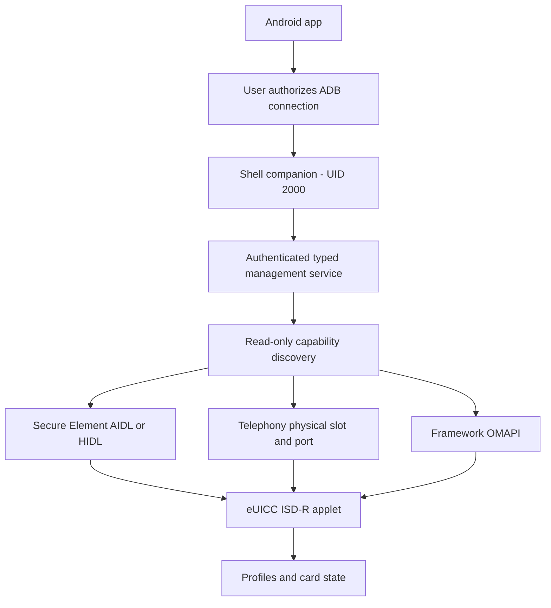
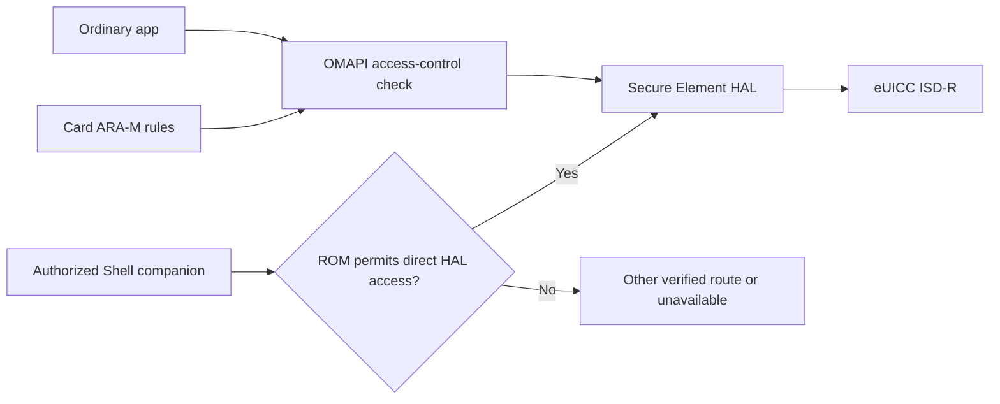

# Architecture and permission boundaries

8bercue is an Android Local Profile Assistant (LPA) client for compatible eUICCs.
The Android access route, the card protocol and operator authentication are
separate layers. Support in one layer does not establish support in the others.

## From the app to the card

The visible app remains an ordinary app. User-authorized ADB starts a local
companion as Android Shell, UID 2000. Shell has more system access than an
ordinary app on some ROMs; it is not root. An authenticated, versioned Binder
interface exposes scoped management operations to the app. A process merely
starting does not establish that the Binder or the card is ready.

Wireless setup uses Android's pairing-code flow and TLS 1.3. The short code
establishes an authorized client identity; subsequent connections use the
remembered app key. The code is not a permanent password. The app discovers local
services and uses the fixed companion entrypoint, rather than exposing a general
ADB command terminal. USB setup starts the same service through an App-created,
short-lived challenge. See [connection setup](ADB_CONNECTION.md).

## What ARA-M controls

ARA-M is a card applet that supplies access rules. Android's OMAPI access-control
implementation uses rules matching a host application, typically its signing
certificate, to a card applet and allowed access. ARA-M is not the operator's
profile-download authentication. The enforcement point discussed here is the
Android service between an ordinary application and the Secure Element HAL.
See [AOSP's access-control implementation](https://android.googlesource.com/platform/packages/apps/SecureElement/+/refs/heads/main/src/com/android/se/security/AccessControlEnforcer.java).

Where the ROM exposes the HAL to Shell, 8bercue can communicate below the ordinary
OMAPI application check. This is the sense in which that access restriction can
be bypassed: it does not rewrite ARA-M, patch Android's service, root the phone or
remove security checks inside the card. The OMAPI fallback still uses the system
access-control service. Binder permissions, SELinux, vendor HAL policy or card
behavior can prevent another phone from using the same route.

The Telephony backend is a separate, experimental route. Its existing fixed-AID
encoding workaround depends on Android framework policy behavior and may be
rejected by patched or different ROMs. It uses the real Shell identity, not an
impersonated system LPA. [Adapters](ADAPTERS.md) describe its boundaries.

## Independent management and vendor limits

An independent LPA can perform standard card/profile management without using a
card vendor's application account. A limit implemented only in the vendor app
or its account service is outside that independent workflow. This can avoid
app-side registration requirements or app-side download counters.

It does not promise unlimited downloads. Card firmware policies, available
storage, operator entitlement, activation-code usage, SM-DP+ server policy and
cryptographic profile authentication remain applicable. A download needs a valid
operator workflow; obtaining an Android card channel does not create a valid
activation code or defeat the eUICC's authentication.

## ROM differences and transaction safety

Discovery inspects available services, required methods, card presence, the fixed
ISD-R applet, complete EID response and owned-channel closure. It tries AIDL,
HIDL, Telephony and OMAPI in order. Multiple verified cards require explicit
selection; uncertainty during cleanup stops fallback. AIDL and Telephony have
scoped management paths. HIDL currently permits reads only.

Card selection is pinned to the full verified identity and reader for the
service session. Each operation rechecks identity and inventory. Writes retain
explicit intent/consent, operation-specific policies, exclusive locking, durable
journals and independent postflight observation. Unknown results stop further
writes and are not silently retried. [Recovery](READ_ONLY_RECOVERY.md) restores
observation separately from resolving an interrupted operation.

Implementation entry points:

- [SystemHalAdapter](../android-app/app/src/main/java/dev/sid/fiveberinspector/SystemHalAdapter.java): system interfaces and transport construction.
- [FiveberReaderSelector](../android-app/app/src/main/java/dev/sid/fiveberinspector/FiveberReaderSelector.java): capability discovery and card identity. The class name is historical; discovery is not a vendor allowlist.
- [SecureElementTransport](../android-app/app/src/main/java/dev/sid/fiveberinspector/SecureElementTransport.java): the common channel interface.
- [ReaderDescriptor](../android-app/app/src/main/java/dev/sid/fiveberinspector/ReaderDescriptor.java): reader namespaces and operation eligibility.
- [OnDeviceAdbWirelessManager](../android-app/app/src/release/java/dev/sid/fiveberinspector/OnDeviceAdbWirelessManager.java): app-owned pairing and reconnect.

For implementation work, start with [CONTRIBUTING.md](../CONTRIBUTING.md) and the
[adapter guide](ADAPTERS.md).

## Card-specific recovery

Each full card identity has an independent current operation, history and review
records under the local Shell service state. Existing global records are read
through a card filter and kept in place; switching cards never rewrites, retries
or confirms an old operation. An unknown result blocks new operations on that
card only. Missing identity bindings or interrupted durability commits require
investigation rather than guessing which card they concern.

The kernel transaction lock remains global because card transports and workers
can share system resources. A worker whose termination is unknown blocks access
until reconnect can verify its identity, retire only the app's owned idle backend
and observe quiescence twice under the same lock. Its quarantine marker is then
archived with a worker-only receipt. This establishes that work has stopped; it
does not resolve any card's unknown operation. Notification delivery and cleanup
use the selected card's transaction history as well.
