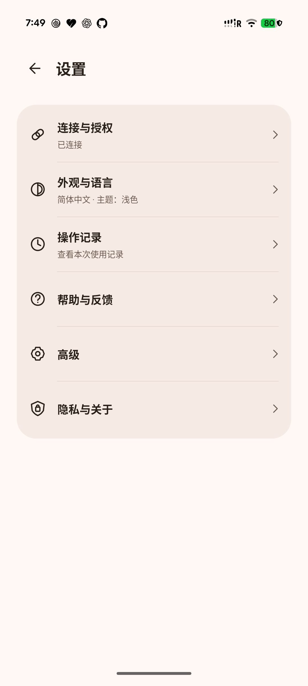
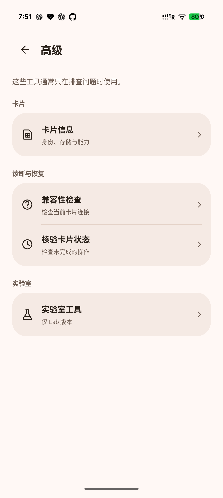

# Grouped settings and connection flow

This UI change follows PR #17 and keeps its management, pairing, card-selection and recovery contracts. The six settings categories replace the former long list of equally prominent actions. The warm palette and existing home/settings navigation are retained.

| Settings category | Contents |
| --- | --- |
| Connection & access | Current connection, user-initiated setup/reconnect, setup help, other connection options |
| Appearance & language | Existing language and light/dark preferences |
| Operation records | Current-session results and contextual verification/review |
| Help & feedback | Setup help, reviewed feedback, diagnostic export format selection |
| Advanced | Card information, compatibility, recovery, laboratory tools in debug/Lab builds |
| Privacy & about | Optional crash reporting, privacy, third-party notices, version |

## Display and action rules

The homepage shows the current card, profile names/states, refresh and Add eSIM. The normal card summary omits EID, slot/port, transport and read-stage diagnostics. Exact card addresses and masked identifiers remain in the explicit card-selection and profile/action review flows and in Advanced → Card information. Card state is distinguished from network service in profile details.

Connection & access uses a neutral Connected status for authenticated management. It does not label an app-initiated wireless connection as a computer connection. A fresh wireless-capable install has one Start setup action; an already-paired user has one reconnect action. The ordinary Release, which still excludes pairing JNI, prominently offers the working computer route. A connected user can return directly to their eSIMs. Other connection choices and explicit re-pairing are secondary.

Setup explains the debugging permission and three user steps. Identity preparation, TLS-exporter tests and endpoint/port discovery are laboratory diagnostics. No endpoint scan, cryptographic self-test, key creation or management command starts just because a settings page is rendered.

The pairing notification retains its private system reply and cancellation. Tapping the notification opens the existing non-exported numeric-input Activity as the keyboard fallback; it is no longer a second competing action. Input labels are bilingual, the code remains masked and unpersisted, and the fallback window now blocks screenshots. The pairing engine and one-shot Binder handoff are unchanged.

Pending or uncertain operations remain visible, with a contextual verification action on Home and Settings. Explicit card choice, operation permissions, delete/install consent and unknown-outcome review remain in place. Diagnostic ZIP and text sharing are choices under one export entry, and do not enable automatic reporting. Existing feedback and optional telemetry consent are preserved.

Settings children return to their parent. Language recreation retains the current settings section, while credentials/profile selections are never restored. A saved computer-connection screen returns to Connection & access and requires a new explicit command window. A Release cannot restore a Lab page. Preferences and navigation do not replay a card operation.

## Exact Lab acceptance — 2026-10-25

- APK SHA-256: `6c07d067b3f0402520585028f0c08303620570f1758ca7dcc8636915a86f8d33`.
- Stable Lab signer: `3a1ebed312d2f5ec257cde4a2966e3b8da7533be20b014bd77a48e171f6329ea`.
- Packaged pairing JNI remains `10f9509cfbd28825f5f4ecc5f05a2e91348c7f350987c568c4a8aa4f5e009c1e`.
- Classification remains `SIGNED_DEBUGGABLE_LAB_ONLY`, `productionReady=false`.

On the owner-controlled Pixel 10, matching-signer upgrades preserved the parsed pairing preferences. The final APK initiated its own local TLS reconnect, authenticated one Shell UID 2000 management worker and typed Binder, explicitly selected the owner-confirmed removable card at physical slot 1 / port 0, and read the same inventory: R&S enabled, Speedtest Travel disabled. No computer-issued bootstrap, re-pairing, data clear, phone reboot, debugging/VPN changes or profile writes were performed.

The final APK passed English navigation through all six categories and Advanced/card/Lab children, help/export-format choices, privacy and Back. Chinese Settings/Advanced/Connection/Appearance and language recreation were observed. Light → dark → light and system language → Chinese → system language round trips passed; the original display choices were restored. Only the specified Pixel 10 was operated on. [Sanitized hardware results](evidence/ui-navigation-20261025.json).

Automated verification:

- 86 UI/command assertions, including safe page restoration, and 23 checks executing the actual connection-page and notification-permission methods with display adapters. These cover fresh/paired/connected/unsupported states, the no-JNI computer route, denied notification permission, explicit retry and active-operation exclusion.
- 2359 bilingual resource/placeholder assertions across 544 string pairs, plus existing feedback/privacy and identity-composition checks.
- Existing 39 provider, 332 compatibility, 76 recovery and 44 actual recovery-entry assertions; protocol/certificate/discovery, 85 artifact-policy and 14 actual pairing/completion-method checks pass. Device/crypto mocks remain labeled.
- Lab/Release assembly and both Lint tasks pass: zero errors, 64 warnings per variant. Actual signed Lab verification passes under optimized Python; ordinary unsigned Release surface/artifact verification passes with required reporting. Gradle unit-test tasks have no sources; substantive regressions are the offline harnesses above.

Fresh six-digit pairing on this UI APK and live wrong-key/unknown-write scenarios were not repeated. Current hardware evidence covers preserved-identity reconnect/read and navigation; the fresh and unsupported UI routes are actual-method tests with adapters. PR #17 contains the earlier real fresh-pairing acceptance. The screenshots below contain no card identifiers; they are real application captures.

| Settings | Advanced (Lab) |
| --- | --- |
|  |  |

This branch does not change native production admission, release signing, licensing or publication gates. It is ready for UI review independently of those remaining delivery decisions.
